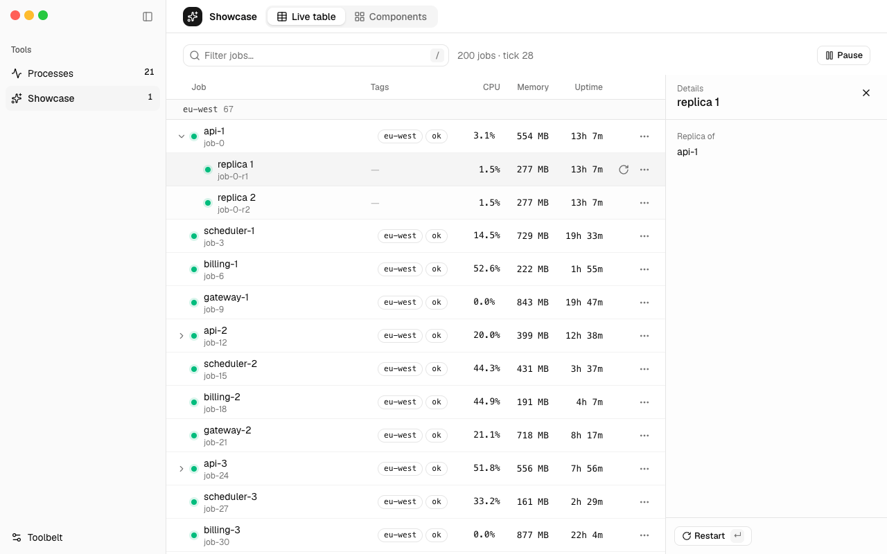
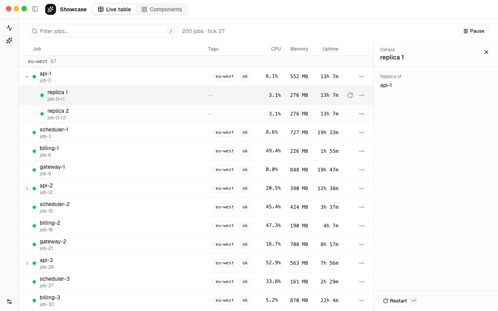
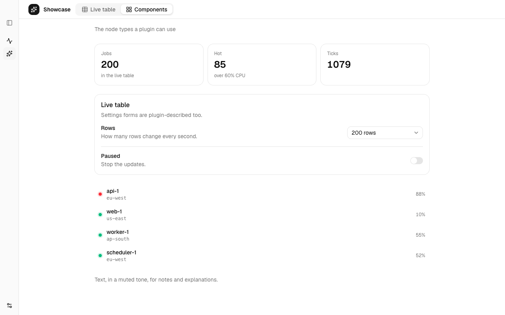
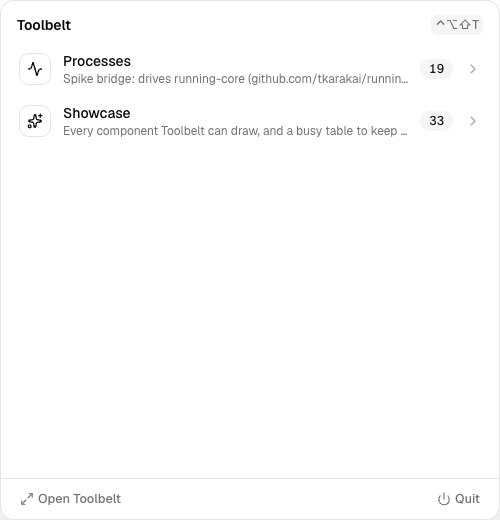
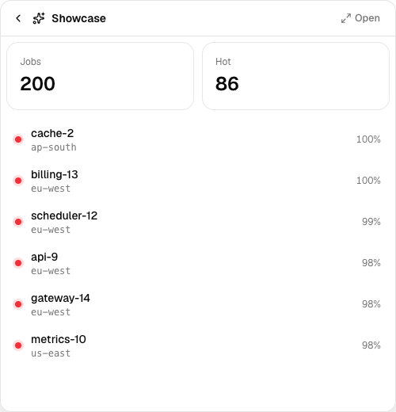

# The spike: what Electrobun + React + shadcn proved (2026-11-09)

The question: can Toolbelt be an Electrobun app that hosts TypeScript plugins whose UI it
renders with shadcn/ui — window, menu bar popover, quick views — before we commit to the stack?

**Short answer: yes.** Everything the plan needs works. The risk is maintenance (Electrobun is
essentially one maintainer), handled by keeping Electrobun a thin shell: the UI is a plain
React app, the plugin protocol and host don't import Electrobun.

| Window: a tool's table, row inspector | Sidebar collapsed to icons |
|---|---|
|  |  |
| **Settings-style page (stats, form, list)** | **Menu bar popover → quick view** |
|  |   |

(Screenshots from `bun run preview` — the same UI and plugins as the app, in Chrome.)

## Verified in the running app

Checked through the debug channel (`TOOLBELT_DEBUG_PORT`) against the real app, and with the
browser preview for screenshots.

| Need | Result |
|---|---|
| Menu bar icon, no native menu | ✅ `Tray` with a template PNG; a click emits `tray-clicked` |
| Popover under the icon | ✅ Borderless, transparent, always-on-top window placed from `tray.getBounds()` |
| Global shortcut | ⚠️ Electrobun's `GlobalShortcut` registers but never fires without Accessibility permission (it's an `NSEvent` global monitor). Replaced with Carbon `RegisterEventHotKey` over `bun:ffi` (`src/bun/hotkey.ts`) — no permission, configurable in Toolbelt's page |
| Dock icon only while the window is open | ✅ `Utils.setDockIconVisible` on open / close (state read back: `true` → `false`) |
| Plugins as Bun child processes | ✅ Started with the app's bundled Bun (`process.execPath`), also in the release build |
| Driving `running`'s engine from a plugin | ✅ 20 live processes, grouped by folder, actions wired |
| Survives being launched from Finder | ✅ Release build, `open Toolbelt.app`: plugins and running-core start |
| Release build | ✅ 32 MB `.dmg` + `.tar.zst` update bundle + `update.json`, ad-hoc signed |
| shadcn/ui in WKWebView | ✅ Sidebar (collapsible to icons, resizable), tabs, table, dialog, dropdown, select, switch, tooltip, sonner |

## Render performance

Time from a plugin's tree arriving to React committing it, Showcase table, **every row
changing every second** (worst case), full trees over the protocol:

| Rows | Chrome (visible) | WKWebView (window behind others, throttled) |
|---:|---:|---:|
| 200 | 22 ms | 54 ms |
| 500 | 42 ms | 37 ms (p50) |
| 1000 | 72 ms | 223 ms |
| 2000 | 125 ms | 416 ms |

Linear, about 60 µs per changed row. Fine for Processes (tens of rows, few change per tick).
Before plugins with thousands of rows: send keyed patches instead of whole trees, and
virtualize long tables. The protocol leaves room for both (`render` → `patch`).

## Quirks found

- **Global shortcuts**: see above — `GlobalShortcut` silently needs Accessibility access.

- **Coordinates**: window frames are top-left based, `Tray.getBounds()` is Cocoa bottom-left.
  The popover flips the tray's y.
- **Hutch lock**: `electrobun build` waits silently while `electrobun dev` runs.
- **Hidden windows are throttled**: `requestAnimationFrame` stops and timers slow down when the
  window is behind others (`document.hidden`), so measure render time, not frame rate.
- **shadcn CLI**: the Nova preset rewrote `@/lib/utils` imports to an unrelated npm package
  `cn` (and added it as a dependency). Fixed by hand; watch for it when adding components.
- The release `.app` is a self-extracting launcher (`Identifier=extractor`): first launch
  unpacks the real app. Its ad-hoc signature fails `codesign --verify --strict` ("code has no
  resources but signature indicates they must be present") — check how Gatekeeper treats a
  downloaded copy before the first release.

## Not verified yet (needs eyes on a screen)

- How the popover looks and feels: rounded transparent corners, shadow, dismissal when clicking
  elsewhere (wired to the window's `blur`), focus behavior.
- Traffic-light placement over the sidebar, expanded and collapsed.
- A self-update round trip, and Gatekeeper on a downloaded `.dmg`.
- Multiple displays (the popover uses the primary display).

## Next

1. Protocol v1: keyed patches, table virtualization, streaming text (the log view), settings
   schema owned by the host, plugin-declared commands (feeding ⌘K, the popover search, and `tb`).
2. `tb` command: dispatcher + `tb <plugin> --json` convention.
3. `@toolbelt/sdk` as a package; plugin install/update from GitHub releases.
4. toolbelt-ps: the Processes plugin on the SDK (replacing the running-core bridge).
5. App icon, the login-shell environment for plugins started from Finder.
